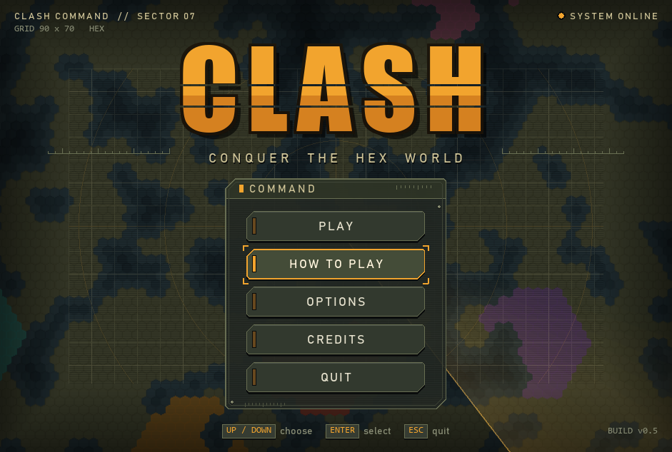
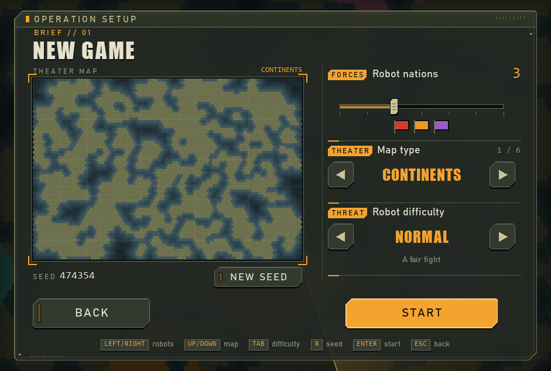
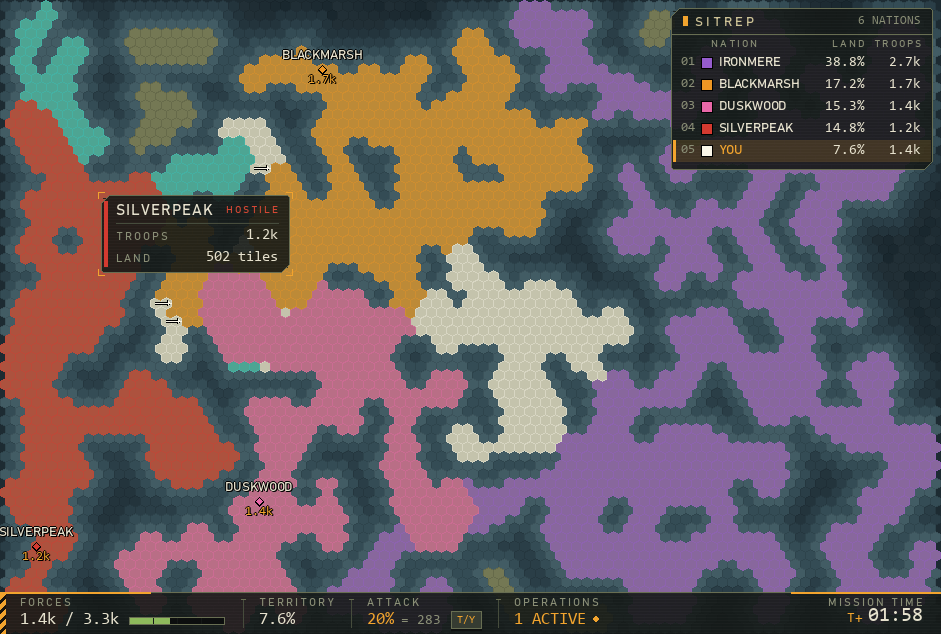
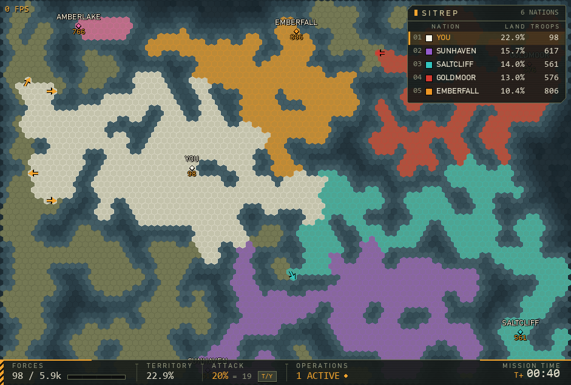
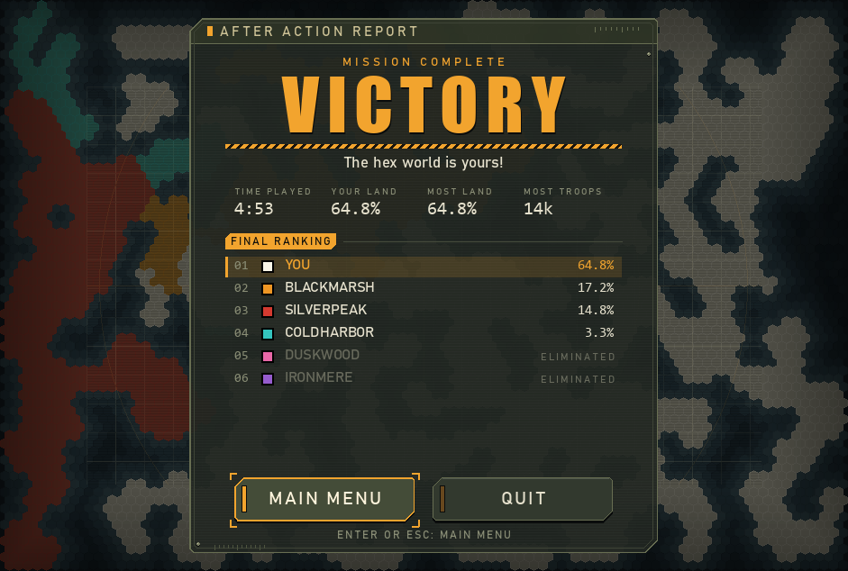

# Clash

**A real-time strategy game on a hex map.** Start as a tiny nation, grow your army and
take the world from up to 7 robot nations, using real military maneuvers like spearheads,
flanks, encirclements and scorched earth. Inspired by [OpenFront.io](https://openfront.io),
made with Python and pygame-ce for [Hack Club](https://hackclub.com) Terra.



| New game | In game |
|---|---|
|  |  |

| Attacks | Victory |
|---|---|
|  |  |

---

## ▶ Play it (Windows, nothing to install)

1. Go to the [**Releases**](../../releases) page of this repository.
2. Download **`Clash.exe`** from the newest release.
3. Double-click it. That's it.

> **"Windows protected your PC"?** Windows warns about every new .exe that isn't signed
> by a big company. Click **More info → Run anyway**.
>
> The first start takes a few seconds, because the game makes its music. Clash puts a
> `sounds` folder and an `options.json` next to the .exe – you can delete them any time.

No release yet? Open the [**Actions**](../../actions) tab, click the newest
"Build Clash.exe" run, and download **Clash-windows** under *Artifacts*.

---

## 🐍 Run it from the source code (Windows, Mac or Linux)

You only need **Python 3.10 or newer** ([python.org/downloads](https://www.python.org/downloads/) –
on Windows, tick **"Add python.exe to PATH"** while installing).

**Windows, the easy way:** download this repository (green **Code** button → **Download ZIP**),
unzip it and double-click **`play.bat`**. It installs what is needed and starts the game.

**Any computer, by hand:** open a terminal in the game folder and run

```
python -m pip install -r requirements.txt
python clash.py
```

(On Windows `py` works instead of `python`, on Mac/Linux it may be `python3`.)
The only thing Clash needs is [pygame-ce](https://pyga.me). All music and sounds are
made by the game's own code, so there is nothing else to download.

### Build the .exe yourself

Double-click **`build.bat`** (Windows). It installs PyInstaller and puts the game in
`dist\Clash.exe`. GitHub also builds it automatically on every push
(see [`.github/workflows/build.yml`](.github/workflows/build.yml)).

---

## How to play

1. Press **Play**. Pick how many robot nations you want, the map type and the difficulty.
2. **Click on land** to choose where you start. You can move it until the countdown ends.
3. Your troops grow by themselves – more land means more troops.
4. **Click free land or an enemy** to send troops there. **T / Y** changes how many you send.

**You win** when you own 70 % of all land, or when every robot nation is gone.
**You lose** when you have no land left.

## Controls

| Key / mouse | What it does |
| --- | --- |
| W A S D / arrow keys | Move the camera |
| Mouse wheel / Q E | Zoom out and in |
| C | Jump to your capital |
| P | Pause |
| T / Y | Send 10 % fewer / more troops per attack |
| Left click | Choose your start, then attack |
| Shift + click | Attack with twice as many troops |
| Double click | Spearhead |
| Ctrl + click | Feint |
| Right click an enemy | Stop your attack on them |
| Right click your own border | Dig in (on / off) |
| Hold R + click your own land | Scorched earth |
| Space | New map (before the game starts) |
| Esc | Pause menu |

## Maneuvers

Everything costs troops – pick the right move for the moment.

| Maneuver | How | What it does |
| --- | --- | --- |
| **Broad front** | Click | Pushes along the whole border. |
| **Spearhead** | Double click | Narrow, fast push to the clicked spot, 30 % cheaper per tile. Far from home it loses troops (supply lines). |
| **Flank** | Automatic | Tiles you touch from 3 sides are 20 % cheaper, from 4+ sides 40 % cheaper. |
| **Encirclement** | Automatic | Cut off enemy land from its capital: the pocket is cheap to take and drains the enemy. |
| **Dig in** | Right click own border | Enemies pay 50 % more for those tiles. Costs a little upkeep. |
| **Scorched earth** | Hold R + click own land | Give up land on purpose – for 30 s enemies pay double to take it. |
| **Feint** | Ctrl + click | Looks like a big attack, but pulls back after 5 seconds. |

## Map types

- **Continents** – a few big land masses
- **Islands** – many small islands
- **Pangaea** – one huge continent
- **Lakes** – mostly land, with lakes and rivers
- **Two Continents** – west and east, split by a narrow strait
- **Ring** – land in a ring around an inner sea

Every map has a **seed**, so you can play the same map again.
Robots come in **Easy**, **Normal** and **Hard**.

## The code

| File | What is in it |
| --- | --- |
| `clash.py` | Starts the game, the main loop |
| `settings.py` | All the numbers you can tweak (map size, troops, speeds, colors) |
| `hexmap.py`, `maps.py` | The hex grid and the 6 map types |
| `nations.py` | Nations, capitals and troop growth |
| `attacks.py` | Attacks and all maneuvers |
| `robots.py` | The robot AI |
| `controls.py`, `camera.py` | Keys and the camera |
| `hud.py`, `menu.py`, `options.py`, `endgame.py` | Everything you see: HUD, menus, options, game over |
| `theme.py`, `widgets.py` | The "War Command" look, buttons and sliders |
| `audio.py`, `soundgen.py` | Music and sound effects, made with math |

## Hack Club Terra

Clash is my project for [Hack Club Terra](https://terra.hackclub.com).
Coding time is tracked with [Hackatime](https://hackatime.hackclub.com) (project **Clash**),

## Credits

- Made by **Lauge** for Hack Club Terra
- Inspired by [OpenFront.io](https://openfront.io)
- Music and sounds made in Python
- Built with [pygame-ce](https://pyga.me)
